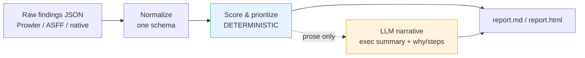

# cloud-risk-explainer

Turns a raw dump of AWS security findings into a prioritized, plain-English risk report that an exec or a client can actually act on. The ranking is deterministic and defensible. The prose is AI-drafted and clearly labeled as such.

I spent years producing the evidence and walking external auditors through AWS environments for ISO 27001, UAE PDPL and Central Bank audits. The hard part was never running the scanner. It was turning hundreds of raw findings into "here is what matters, here is why, fix these three first" for someone who does not read ARNs. That translation is what this tool does.

## The problem

Prowler or Security Hub hand you a JSON file with hundreds of findings, all shouting at once. A CxO or a client does not want a 300-row table. They want: how bad is it, what are the themes, and what do we fix first. Doing that by hand for every account, every month, is the boring part of the job.

## What it does

1) Imports findings from **Prowler-style** JSON, **AWS Security Hub (ASFF)** JSON, or a simple native schema (auto-detected).
2) Normalizes every finding to one shape: `{id, title, service, severity, resource, description, remediation_hint}`.
3) Scores and ranks each finding **deterministically**: severity weight amplified by exposure signals (public exposure, internet-facing SG, wildcard IAM, unencrypted data, logging disabled).
4) Asks a local LLM to write the **prose only**: an executive summary and, for each high/critical finding, a "why this matters" plus concrete remediation steps.
5) Writes a clean `report.md` (and optional `report.html`) with an exec summary, a prioritized table, and per-finding detail.

The split is the whole point: numbers and ranking are code, so they are reproducible. The LLM never touches the score. If the LLM is offline, the tool still produces the full ranked report with deterministic fallback text.

## Architecture



## Quickstart

```bash
# 1) install (only dependency is pytest; the tool itself is pure stdlib)
make install

# 2) run the offline test suite (no network, no API key)
make test

# 3) generate a report, deterministic and fully offline (no LLM)
make demo        # writes report.md + report.html from the Prowler sample

# 4) generate with the AI narrative (needs a local Ollama; see .env.example)
make run         # falls back to deterministic text if the LLM is unreachable
```

Or call it directly:

```bash
python -m cloud_risk_explainer -i sample/asff_findings.json -o report.md --html report.html
python -m cloud_risk_explainer -i sample/prowler_findings.json --no-llm   # offline
```

## Supported input formats

| Format | Detected by | Mapped from |
|---|---|---|
| **Prowler** | `CheckID` / `CheckTitle` / `ServiceName` keys | `CheckID`, `CheckTitle`, `ServiceName`, `Severity`, `ResourceArn`, `StatusExtended`, `Remediation.Recommendation.Text` |
| **AWS Security Hub (ASFF)** | `{"Findings": [...]}` or `SchemaVersion` / `Severity.Label` | `Id`, `Title`, resource ARN service, `Severity.Label`/`Normalized`, `Resources[0].Id`, `Description`, `Remediation.Recommendation.Text` |
| **Native** | anything else | the normalized schema directly |

Findings explicitly marked PASS / PASSED / ARCHIVED are dropped, because a risk report is about what is wrong. Use `--format` to override auto-detection.

## Sample run (input to output)

Input: `sample/prowler_findings.json` (16 actionable findings across S3, IAM, EC2/SG, RDS, CloudTrail, KMS).

Console:

```
Analyzed 16 findings from sample/prowler_findings.json (prowler).
Top risk: #1 [92.0] Ensure RDS instances are not publicly accessible
Narrative: deterministic fallback (no LLM)
Wrote: report.md, report.html
```

Top of the prioritized table in `report.md`:

```
| # | Score | Band     | Severity | Service    | Finding                                             | Exposure                            |
|---|-------|----------|----------|------------|-----------------------------------------------------|-------------------------------------|
| 1 | 92.0  | Critical | Critical | rds        | Ensure RDS instances are not publicly accessible    | Public exposure, Unencrypted        |
| 2 | 80.0  | Critical | Critical | s3         | Ensure S3 buckets are not publicly accessible       | Public exposure                     |
| 3 | 65.0  | Critical | High     | ec2        | SG allows ingress from 0.0.0.0/0 to port 22         | Public exposure, Internet-facing SG |
| 4 | 65.0  | Critical | High     | kms        | KMS key policies should not allow public access     | Public exposure, Wildcard IAM       |
| 5 | 40.0  | High     | High     | iam        | IAM policies should not grant full admin privileges | Wildcard IAM                        |
```

A publicly reachable critical outranks every internal-only finding, every run, because exposure multiplies severity.

## How it works

`score = severity_weight x (1 + sum of exposure signal weights)`

- Severity weight: CRITICAL 40, HIGH 25, MEDIUM 12, LOW 5, INFORMATIONAL 1.
- Exposure multiplier adds: public exposure +1.0, internet-facing SG +0.6, wildcard IAM +0.6, unencrypted +0.3, logging disabled +0.2.
- Signals are inferred deterministically by keyword from each finding's own text, so the same input always produces the same ranking. Tie-break is score, then severity, then id.

The LLM (via `llm.py`, an OpenAI-compatible call defaulting to local Ollama) is used strictly for prose. Every AI-written section is labeled AI-generated in the output and the report states a human must review it before acting. This is a triage and drafting aid, not a compliance attestation.

## Demo


## Tech stack

Python 3 standard library only at runtime (`urllib`, `json`, `dataclasses`). `pytest` for the offline test suite. A local LLM through any OpenAI-compatible endpoint (Ollama by default) for the narrative. No cloud account, no API key, no data leaves the machine.

## License

MIT, Al Amin Bashir Afara, 2026. See [LICENSE](LICENSE).
